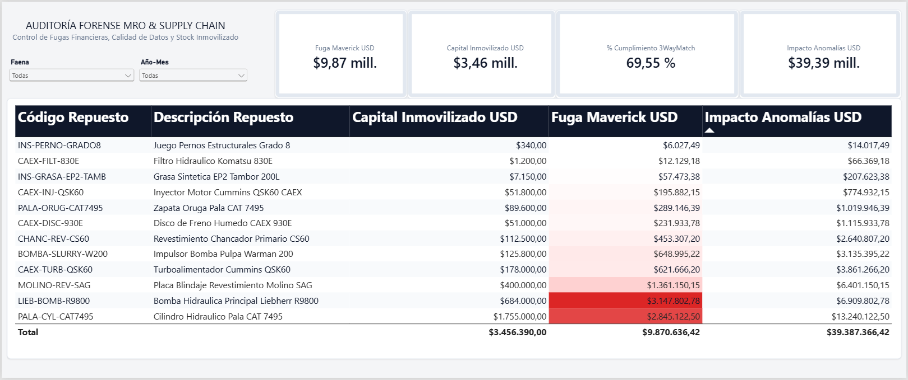
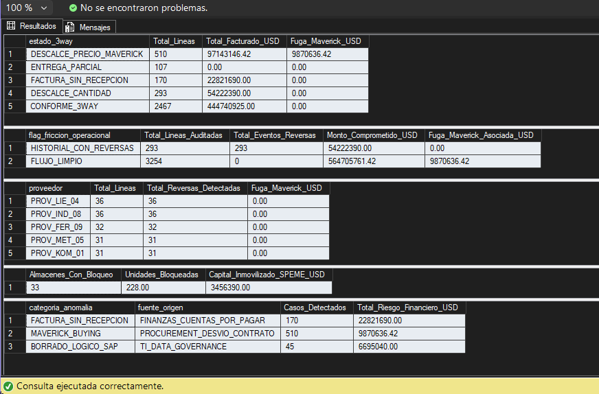
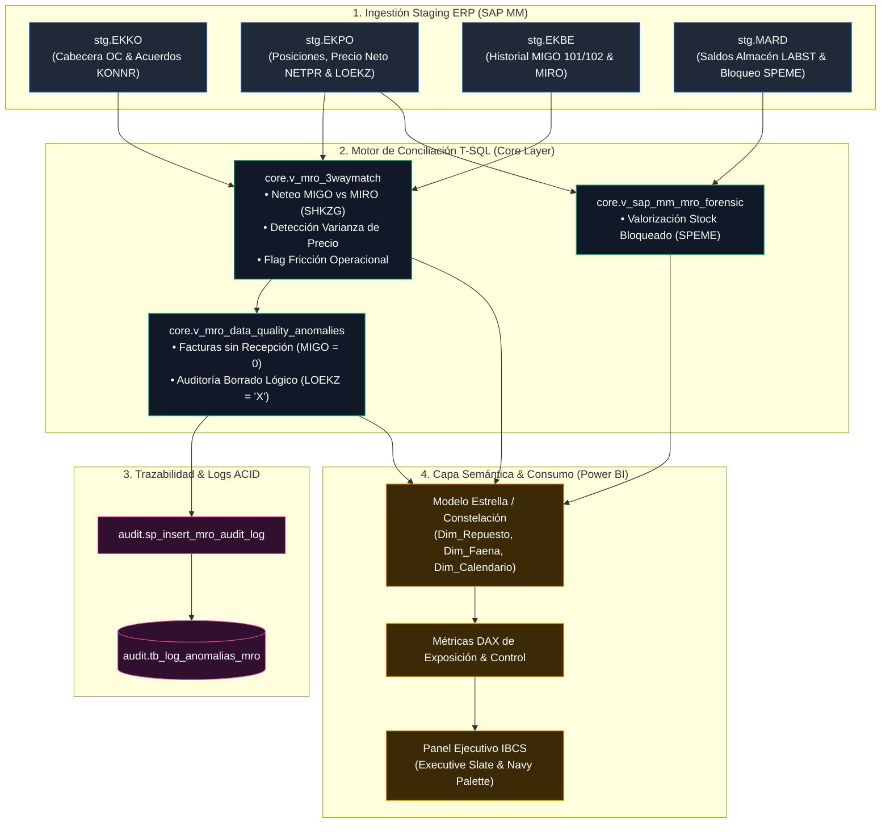
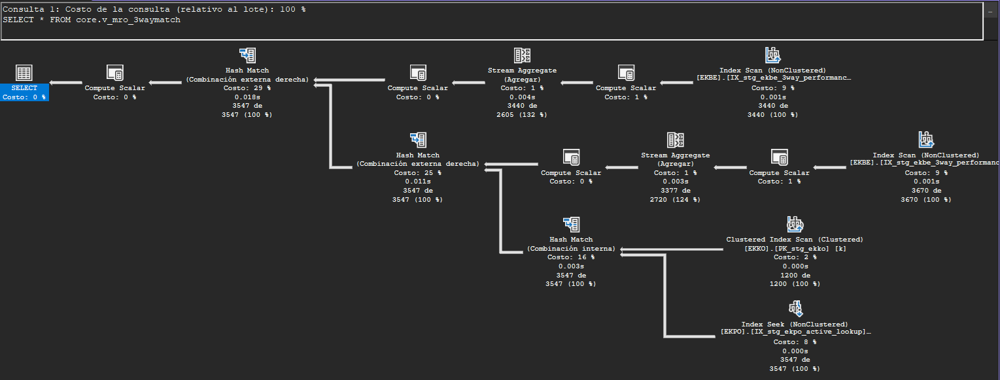

# Mining MRO Analytics Platform ⛏️📊

## Motor de Auditoría Transaccional SAP MM, Conciliación 3-Way Match y Reportería Semántica IBCS

[](#)
[](#)
[](#)
[-007DB8?logo=sap)](#)
[](#)
[](#)

---

## 1. Resumen Ejecutivo & Propósito del Modelo

En las operaciones de minería de rajo abierto y procesamiento de mineral (equipos de extracción CAEX, palas electromecánicas y molienda SAG), el aprovisionamiento de repuestos e insumos **MRO (*Maintenance, Repair, and Operations*)** concentra riesgos críticos de descalces transaccionales, sobrecostos por compras fuera de tarifa pactada e inmovilización de capital de trabajo en bodega.

Esta plataforma implementa un **motor relacional de auditoría preventiva y forense en T-SQL** conectado a una **capa de visualización ejecutiva en Power BI bajo estándar IBCS**, diseñado para automatizar la conciliación *3-Way Match* (Orden de Compra vs. Recepción Física vs. Factura), auditar variaciones de precios frente a acuerdos comerciales y monitorear stock bloqueado.

> **Nota Metodológica sobre el Dataset:** Los montos y transacciones expuestos a continuación corresponden a un conjunto de datos sintético y determinista generado específicamente para simular escenarios de estrés operacional, anomalías transaccionales y pruebas unitarias sobre la estructura del diccionario de datos de **SAP ERP (Módulo MM)**. Los valores representan exposición financiera calculada por el motor de reglas (alertas de auditoría previas a la conciliación contable definitiva en SAP FI).

<p align="center">
  
</p>

### Resultados del Modelo sobre el Escenario Simulado (Corte Consolidado):

* **USD 9,87M en Exposición por Varianza de Precio y Desvío de Tarifa (*Maverick / Off-Contract Variance*):** Sobrecosto potencial detectado en facturación (`MIRO`) por encima del precio neto pactado en la orden de compra / acuerdo marco (`EKPO-NETPR` / `KONNR`).
* **USD 3,46M en Capital Inmovilizado en Calidad (`MARD-SPEME`):** Componentes críticos retenidos bajo bloqueo de inspección técnica en pañoles y bodegas operativas, restringiendo la disponibilidad operativa y el capital de trabajo.
* **69,55% de Cumplimiento 3-Way Match:** Identificación de un ~30,45% de posiciones de compra con fricción operativa o descalces entre la Orden de Compra (`PO`), la Recepción Física (`MIGO`) y la Recepción de Factura (`MIRO`).
* **USD 39,39M de Exposición Global en Transacciones Observadas:** Volumen bruto transaccional comprometido en registros que presentan anomalías de integridad, facturas sin recepción física registrada o partidas con borrado lógico (`LOEKZ = 'X'`).
* **Concentración de Exposición (Pareto 80/20):** El **74,5%** del desvío de precios simulado ($7,35M USD) se concentra en 3 componentes críticos de alta rotación: Bomba Hidráulica Liebherr R9800 (`LIEB-BOMB-R9800`), Cilindro Hidráulico Pala CAT 7495 (`PALA-CYL-CAT7495`) y Revestimiento Molino SAG (`MOLINO-REV-SAG`).

<p align="center">
  
</p>

---

## 2. Arquitectura de la Solución End-to-End

```text
MiningMRO_Engine/
├── SQL/
│   ├── 00_init/               --> Creación de BD (Bunker_MRO) y aislamiento RCSI
│   ├── 01_ddl_tables/         --> Tablas staging tipadas según diccionario SAP MM (EKKO, EKPO, EKBE, MARD)
│   ├── 02_ingestion/          --> Carga transaccional masiva y validaciones volumétricas
│   ├── 03_views/              --> Neteo MIGO/MIRO, lógica 3-Way Match y vistas de anomalías
│   ├── 04_stored_procedures/  --> Procedimiento transaccional ACID con bloques TRY...CATCH para logging
│   ├── 05_indexes/            --> Índices Non-Clustered y Covering Indexes para acelerar lecturas
│   └── 06_tests/              --> Test Harness unitario con fixtures deterministas en memoria
├── bi/
│   ├── pbix/                  --> Archivo maestro Power BI (Mro_mining.pbix)
│   └── dax/                   --> Medidas DAX de auditoría documentadas en texto plano
├── docs/
│   ├── SPEC.md                --> Especificación técnica y catálogo de reglas de auditoría
│   └── img/                   --> Evidencias de planes de ejecución y pruebas unitarias
├── reports/
│   ├── Mro_mining.pdf         --> Entregable ejecutivo consolidado de 1 página
│   └── dashboard_preview.png  --> Captura del dashboard en alta resolución
└── README.md
```

### Linaje de Datos: Del Diccionario SAP MM a la Decisión Operacional



---

## 3. Lógica Transaccional de Negocio (Backend T-SQL)

### Neteo Transaccional MIGO/MIRO y Detección de Fricción en Bodega

Para evitar falsos positivos provocados por devoluciones o anulaciones de movimientos en centro de distribución/pañol, las CTEs consolidan el historial del pedido (`stg.EKBE`) evaluando el indicador Debe/Haber (`SHKZG`):

* **Entrada de Mercancías (`VGABE = 1`):** Recepción física en bodega (`BWART = 101` / Cargo `S`) neteada contra anulaciones o devoluciones (`BWART = 102` / Abono `H`).
* **Verificación de Facturas (`VGABE = 2`):** Facturas registradas (`MIRO` / Cargo `S`) neteadas contra notas de crédito o anulaciones (`H`).
* **Flag de Fricción Operacional:** Si una posición registra múltiples reversas pero su balance neto converge a cero, el motor conserva la trazabilidad etiquetándola como `HISTORIAL_CON_REVERSAS` para auditar retrabajos en recepción.

### Árbol de Decisión para Conciliación 3-Way Match

El motor clasifica el estado de auditoría de cada posición de compra (`EBELN` + `EBELP`) evaluando jerárquicamente las desviaciones:

```text
SI Cantidad_MIGO = 0 Y Cantidad_MIRO > 0       -> 'FACTURA_SIN_RECEPCION'
SI P.U._MIRO > (P.U._Contrato_PO + 0.01)       -> 'DESCALCE_PRECIO_MAVERICK'
SI Cantidad_MIRO > Cantidad_MIGO               -> 'DESCALCE_CANTIDAD'
SI Cantidad_MIGO < Cantidad_PO Y MIGO > 0      -> 'ENTREGA_PARCIAL'
EN CUALQUIER OTRO CASO                         -> 'CONFORME_3WAY'
```

---

## 4. Modelado Semántico y Métricas DAX (Power BI)

El modelo semántico importa las vistas de la capa `core` de SQL Server mediante relaciones de 1 a varios (`1:*`) unidireccionales. *(Nota: En el modelo semántico, las vistas mantienen los nombres de columna originales para trazabilidad directa con los scripts SQL)*.

### 4.1. Exposición por Varianza de Precio / Desvío Maverick (USD)

Cuantifica el sobrecosto facturado (`MIRO`) por sobre el precio unitario pactado en la orden de compra (`EKPO-NETPR`):

```dax
Fuga Maverick USD = 
SUM(core_v_mro_3waymatch[fuga_maverick_usd])
```

### 4.2. Capital Inmovilizado en Control de Calidad (`SPEME` USD)

Valorización del stock físico bloqueado por inspección de calidad (`MARD-SPEME`) multiplicado por el costo unitario de referencia en `EKPO`:

```dax
Capital Inmovilizado USD = 
SUM(core_v_sap_mm_mro_forensic[capital_inmovilizado_speme_usd])
```

### 4.3. Tasa de Cumplimiento 3-Way Match (%)

Proporción de posiciones de compra conciliadas exitosamente sin desviaciones de precio, cantidad ni recepción pendiente:

```dax
% Cumplimiento 3WayMatch = 
DIVIDE(
    CALCULATE(
        COUNTROWS(core_v_mro_3waymatch),
        core_v_mro_3waymatch[estado_3way] = "CONFORME_3WAY"
    ),
    COUNTROWS(core_v_mro_3waymatch),
    0
)
```

### 4.4. Exposición Consolidada por Anomalías Transaccionales (USD)

Monto total asociado a registros con alertas de gobierno de datos, imputaciones sobre posiciones con borrado lógico (`LOEKZ = 'X'`) o facturas sin ingreso físico en bodega:

```dax
Impacto Anomalias USD = 
SUM(core_v_mro_calidad_datos_anomalias[impacto_financiero_usd])
```

---

## 5. Diseño Ejecutivo & Estándares IBCS

El tablero de control aplica los principios del **International Business Communication Standards (IBCS)** para maximizar la densidad informativa y reducir la carga cognitiva en revisiones de contraloría:

* **Paleta Corporativa *Executive Slate & Navy*:** Azul Marino Oscuro (`#0F172A`) para jerarquía titular, Gris Pizarra (`#64748B`) para contexto secundario y Gris Suave (`#F4F5F7`) para el lienzo base.
* **Codificación Semafórica Semántica:** Formato condicional de 3 niveles aplicado a las desviaciones monetarias: neutro en blanco (`#FFFFFF`), alerta preventiva en rosa pálido (`#FECACA`) y desvío crítico en rojo intenso (`#DC2626`), reservando el color de alta saturación exclusivamente para anomalías que requieren acción correctiva.
* **Consistencia Estructural:** Tarjetas de KPI estandarizadas y alineación matricial para facilitar la comparación directa entre faenas, familias de repuestos y estados de conciliación.

---

## 6. Rendimiento en Base de Datos, Indexación y Testing Unitario

* **Aislamiento de Lecturas No Bloqueantes (RCSI):** Base de datos configurada con `READ_COMMITTED_SNAPSHOT ON` para garantizar que las consultas analíticas y extracciones de BI no generen bloqueos de lectura/escritura (*locking contention*) frente a transacciones operativas.
* **Índices de Cobertura (*Covering Indexes*):**
  * `IX_stg_ekbe_3way_performance`: Elimina operaciones de *Key Lookup* durante el agrupamiento de movimientos `MIGO`/`MIRO` sobre `stg.EKBE`.
  * `IX_stg_ekpo_active_lookup`: Optimiza el filtrado de posiciones activas (`LOEKZ IS NULL`) mediante *Index Seek*.
  * `IX_stg_mard_speme_quality`: Acelera el aislamiento de lotes con saldo mayor a cero en stock bloqueado (`SPEME > 0`).
* **Test Harness Unitario:** Script de validación automatizada (`SQL/06_tests/01_test_harness_3way_fixtures.sql`) que ejecuta 5 casos de borde en memoria (Match Exacto, Varianza de Precio, Factura sin MIGO, Reversa Total 101/102 y Borrado Lógico) exigiendo **100% PASS** antes de certificar cambios en las vistas.

<p align="center">
  
</p>

---

## 7. Instrucciones de Despliegue Local

1. Clonar el repositorio desde la terminal:

   ```bash
   git clone https://github.com/ObedFermin/MiningMRO_Engine.git
   cd MiningMRO_Engine
   ```
2. Ejecutar los scripts T-SQL en orden secuencial dentro de **SQL Server Management Studio (SSMS)**:
   * `SQL/00_init/01_create_database.sql` *(crea la instancia `Bunker_MRO` con RCSI activo)*
   * `SQL/00_init/02_create_schemas.sql` *(esquemas `stg`, `core`, `audit`)*
   * `SQL/01_ddl_tables/` *(creación de tablas staging SAP MM y bitácora de auditoría)*
   * `SQL/02_ingestion/01_bulk_insert_sap_data.sql` *(poblado del dataset sintético de prueba)*
   * `SQL/03_views/` *(despliegue de vistas de conciliación y anomalías)*
   * `SQL/04_stored_procedures/` *(procedimiento de registro ACID)*
   * `SQL/05_indexes/` *(creación de índices de cobertura)*
3. Validar la integridad de las reglas ejecutando el test suite: `SQL/06_tests/01_test_harness_3way_fixtures.sql`.
4. Abrir el archivo `bi/pbix/Mro_mining.pbix` en **Power BI Desktop**, apuntar el parámetro de origen de datos a tu instancia local de SQL Server (base `Bunker_MRO`) y actualizar el modelo.
